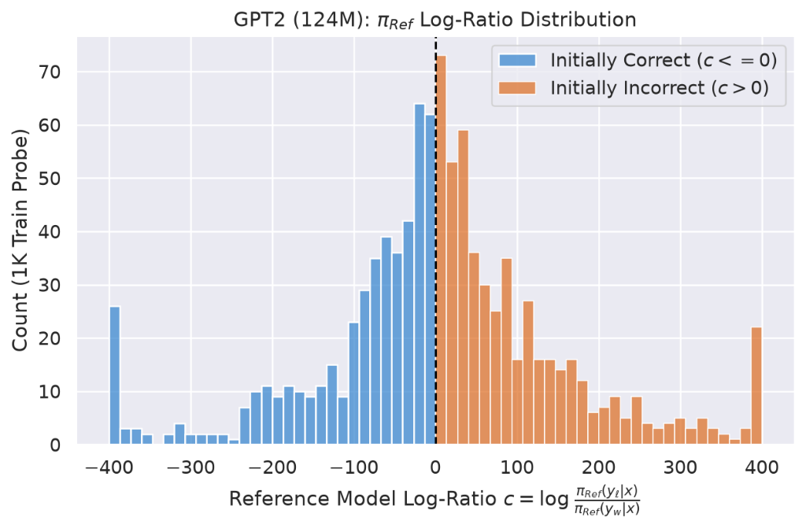
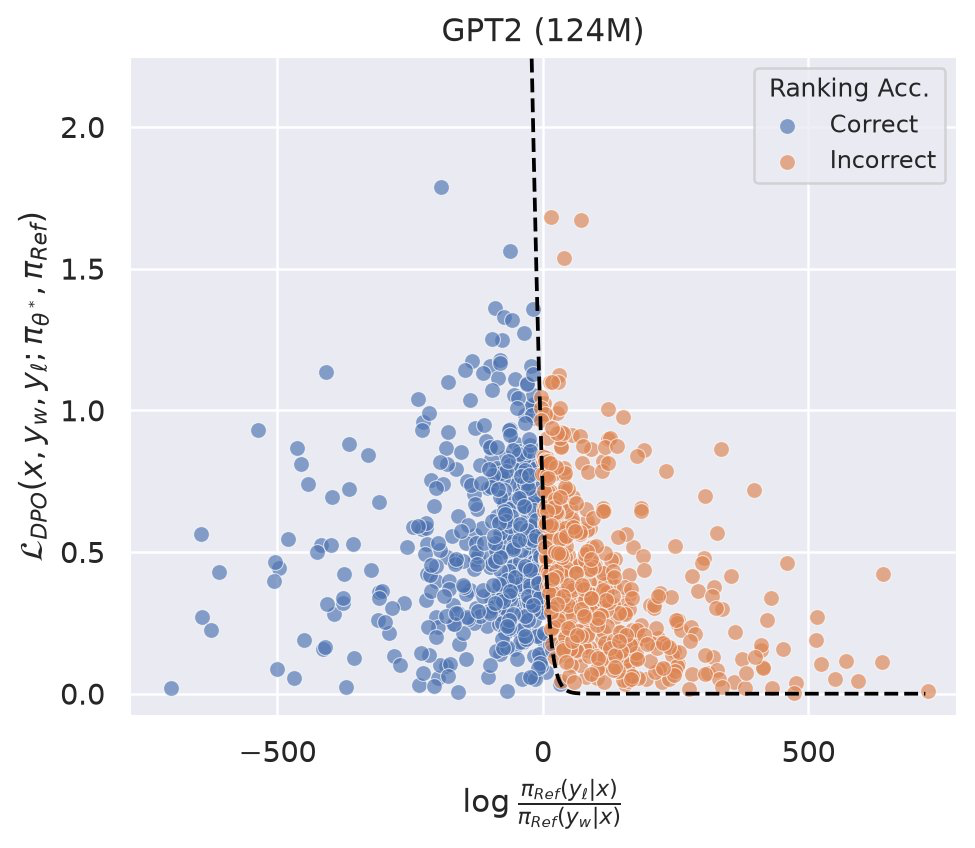

# Preference Learning Algorithms Do Not Learn Preference Rankings

[](https://github.com/aayushmanda/Pref_Ranking/) [](https://colab.research.google.com/drive/15joRmKadegeO1RI3dHm79bjFBoDKGjWD) [](https://github.com/angie-chen55/pref-learning-ranking-acc)

**Author:** Aayushman  
**Links:** [Report (`report.pdf`)](./report.pdf) · [LaTeX (`report.tex`)](./report.tex) · [Notebook (`code.ipynb`)](./code.ipynb) · [ Project Repo](https://github.com/aayushmanda/Pref_Ranking/) · [ Official Paper Repo](https://github.com/angie-chen55/pref-learning-ranking-acc)

**Author:** Aayushman  
**Links:** [Report (`report.pdf`)](./report.pdf) · [LaTeX (`report.tex`)](./report.tex) · [Notebook (`code.ipynb`)](./code.ipynb) · [ Project Repo](https://github.com/aayushmanda/Pref_Ranking/)

---

## Overview

Direct Preference Optimization (DPO) steadily reduces training loss across epochs, yet **Chen et al. (NeurIPS 2024)** show that DPO-tuned language models achieve `< 60%` pairwise ranking accuracy and fix `< 10%` of reference-model ranking errors before validation overfitting.

This repository investigates **why DPO reduces loss without flipping wrong rankings** through analytical derivations, an audit of the authors' official codebase, floating-point precision checks, and a full-parameter PyTorch **`GPT-2` (124M)** pipeline trained on `16,000` `Anthropic/hh-rlhf` dialogue pairs on a single GPU.

---

## Repository Structure & Quickstart

```text
.
├── code.ipynb                         # End-to-end PyTorch notebook (SFT -> log-prob cache -> 5-epoch DPO)
├── report.pdf                         # Compiled 12-page NeurIPS-style report
├── report.tex                         # LaTeX source (+ neurips_2024_11pt.sty, references.bib)
└── dpo_ranking_replication_outputs/   # Saved figures and checkpoint metrics from A100 run
```

```bash
pip install "torch>=2.1.0" "transformers>=4.40.0" "datasets>=2.19.0" "accelerate>=0.30.0" matplotlib seaborn pandas numpy tqdm
```

Open [`code.ipynb`](./code.ipynb) (or launch in [Google Colab](https://colab.research.google.com/drive/15joRmKadegeO1RI3dHm79bjFBoDKGjWD)), pick a `preset` in **Cell 2** (`"quick_smoke_test"`, `"fast_t4"`, or `"medium_colab"` default with `16K` train / `2K` val / `1K` probe), and run all cells.

---

## How the Code Works

1. **Clean Dialogue Parsing (`Cells 3–5`):** Backtracks from the first character divergence to the last shared `\n\nAssistant:` header, drops `922` train / `47` test exact ties or empty replies, tokenizes prompt and response separately, and **left-truncates** long prompts within `512` tokens so responses are never cut off.
2. **Stage 1 SFT & Reference Caching (`Cell 6`):** Fine-tunes `gpt2` (`124M`) for `1` epoch on preferred replies (`AdamW`, `lr = 1e-5`), then caches exact frozen reference log-probabilities once for Train, Val, and the `1,000`-pair Probe to halve GPU memory during DPO.
3. **Stage 2 Five-Epoch DPO (`Cells 7–8`):** Initializes from SFT, disables all `37` `GPT-2` dropout layers so `train()` log-probabilities match cached `eval()` reference log-probabilities at Step 0, and trains for `5` epochs (`2,500` steps, `beta = 0.1`, `RMSprop`, `lr = 1e-6`) while tracking `4` trajectory groups (`C->C`, `C->I`, `I->C`, `I->I`).
4. **Precision & Official-Code Fixes (`Cell 5`):**
   - **Master weights in `float32`:** Pure `bfloat16` weights round `1e-6` `RMSprop` updates to zero (`loss` stuck at `0.6931`), so trainable weights stay in `float32` under `bfloat16` autocast.
   - **Piecewise exact log-sigmoid:** Standard `float32` `-F.logsigmoid` rounds `1 + exp(-u)` to `1.0` (`loss = 0`) for large reference gaps (`c >= 167`), causing `85.1%` false flips. `neg_logsigmoid_exact` uses `log1p(exp(-u))` in `float64` for `u > 10` (`0%` false flips).
   - **Log-space evaluation:** Avoids both the missing `np.exp` bug in `rlhf_minimizer_client.py` and `float64` `exp` overflow (`> 709.78`) in `calibration_metrics_lib.py`.

---

## Results (`GPT-2` 124M, `NVIDIA A100 80GB`)

| Stage / Subset | Probe DPO Loss | Reward Margin | Probe Acc (Raw / Len-Norm) | Val Acc (Raw / Len-Norm) | Misranked Pairs Flipped |
| :--- | :---: | :---: | :---: | :---: | :---: |
| **Pretrained `GPT-2`** | — | — | `46.6% / 53.6%` | — | — |
| **Stage 1: SFT Reference (Step 0)** | `0.6931` | `+0.000` | `48.1% / 55.1%` | `48.2% / 52.2%` | `0 / 519 (0.0%)` |
| **Stage 2: DPO Best Val (`t* = 1,100`)** | **`0.4690`** | **`+0.751`** | **`49.8% / 62.7%`** | **`48.5% / 55.5%`** | **`22 / 519 (4.24%)`** |
| **Stage 2: DPO End (`Epoch 5, Step 2,500`)** | `0.3807` | `+1.115` | `51.4% / 65.6%` | Overfit | `36 / 519 (6.94%)` |
| **Hard-to-Learn Slice (`c > 100`, `n = 202`)** | **`0.217` (med)** | — | `0.0%` raw | — | **`0 / 202 (0.0%)`** |

### 1. Dialogue Length Spread (`16,000` Pairs)

Preferred and dispreferred replies have similar medians (`39` vs. `36` words), but a `51.9`-word pairwise standard deviation (`+86` words at the 95th percentile). Long preferred replies accumulate hundreds of extra nats of negative log-likelihood, creating severe initial reference misrankings (`c > 100`).

### 2. Five-Epoch DPO Training Dynamics

Mean probe loss falls by `45.1%` (`0.6931 -> 0.4690` at `t* = 1,100` -> `0.3807` at Step `2,500`) and reward margins climb across all optimized subsets, yet only **`4.24%` (`22/519`)** of misranked pairs flip into `incorrect->correct` by `t*`.

### 3. Reference Log-Ratio Distribution & Exact Flipping Boundary
<p align="center">
  
  
</p>

- **Left:** After SFT, `51.9%` (`519 / 1,000`) of probe pairs remain misranked (`c > 0`), with `30.7%` exceeding `c = 50` (requiring DPO loss `<= 0.0067` to flip).
- **Right:** At `t* = 1,100`, **`1,000 / 1,000` (`100.0%`)** of probe pairs obey the exact theoretical boundary `L_DPO <= -log sigma(beta * c)`.

### Key Takeaways

- **SFT lowers perplexity, not ranking error:** SFT reaches `2.3635` validation NLL but lifts probe ranking accuracy by only `+1.5 pp` (`46.6% -> 48.1%`).
- **The Hard-Tail Loss Paradox:** Pairs with `c > 100` (`20.2%` of probe, preferred reply `2.5x` longer) achieve the **lowest median DPO loss (`0.217`)** of all subsets while flipping **`0.0%`** of the time (`2.16e-8` loss required), because shifting policy log-ratios by `+c` saturates sigmoid gradients long before rankings cross zero.
- **Length normalization recovers `+7.6 pp`:** Per-token normalized accuracy rises from `55.1% -> 62.7%` at `t*` (`65.6%` at Epoch 5), showing that sequence-length penalties mask genuine per-token preference gains.
- **Claim 2's idealized gap is overstated:** Clamping `4/4` rater votes to `0.999` inflates the flip cutoff nearly `5x`, and a missing `np.exp` in `rlhf_minimizer_client.py` inverts length penalties when computing unnormalized idealized accuracy.

---

## Reference

- Angelica Chen, Sadhika Malladi, Lily H. Zhang, Xinyi Chen, Qiuyi Zhang, Rajesh Ranganath, and Kyunghyun Cho. *Preference Learning Algorithms Do Not Learn Preference Rankings.* NeurIPS 2024 (`arXiv:2405.19534v4`). Official code: [github.com/angie-chen55/pref-learning-ranking-acc](https://github.com/angie-chen55/pref-learning-ranking-acc).
