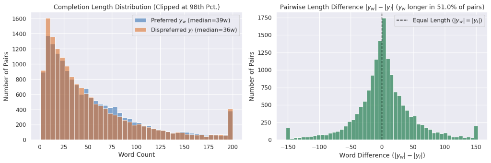
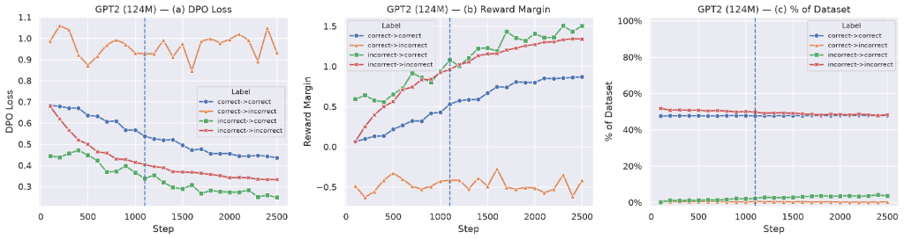

# Preference Learning Algorithms Do Not Learn Preference Rankings: An Empirical and Theoretical Investigation of Chen et al. (2024)

[](https://github.com/aayushmanda/Pref_Ranking/) [](https://colab.research.google.com/drive/15joRmKadegeO1RI3dHm79bjFBoDKGjWD)
**Author:** Aayushman  
**Repository:** [ `aayushmanda/Pref_Ranking`](https://github.com/aayushmanda/Pref_Ranking/) | **Report PDF:** [`report.pdf`](./report.pdf) | **LaTeX Source:** [`report.tex`](./report.tex) | **Notebook:** [`code.ipynb`](./code.ipynb)

---

## Overview

Direct Preference Optimization (DPO) steadily reduces training loss across epochs, so it is natural to expect a DPO-trained policy $\pi_\theta$ to assign higher likelihood to preferred responses ($y_w$) than to dispreferred responses ($y_l$). However, Chen et al. (NeurIPS 2024) show that preference-tuned language models achieve pairwise ranking accuracy $\mathcal{R}(\pi_\theta) < 60\%$ and flip fewer than $10\%$ of reference-model ranking errors before validation overfitting.

This project investigates **why DPO minimizes training loss without learning pairwise preference rankings** through mathematical derivations, a line-by-line audit of the authors' official codebase, IEEE-754 floating-point analysis, and a full-parameter PyTorch **`GPT-2` (124M)** pipeline trained on human preference dialogues (`Anthropic/hh-rlhf`). Under a single-GPU compute budget, we train full-parameter `gpt2` (`124M`) on `16,000` cleaned pairs (`1,000`-pair training probe and `2,000`-pair validation split) instead of Chen et al.'s multi-GPU `160K`-pair runs on larger models.

### Core Mathematical Formulation & Notation

For a prompt $x$ and candidate replies $(y_w, y_l)$ of token lengths $\ell_w$ and $\ell_l$, three scalar quantities govern DPO training and evaluation relative to the frozen supervised fine-tuned (SFT) reference policy $\pi_{\mathrm{ref}}$:

$$\delta_\theta = \log \frac{\pi_\theta(y_w \mid x)}{\pi_\theta(y_l \mid x)}, \qquad c = \log \frac{\pi_{\mathrm{ref}}(y_l \mid x)}{\pi_{\mathrm{ref}}(y_w \mid x)}, \qquad u_\theta = \beta(\delta_\theta + c) = \beta \log \frac{\pi_\theta(y_w \mid x)}{\pi_{\mathrm{ref}}(y_w \mid x)} - \beta \log \frac{\pi_\theta(y_l \mid x)}{\pi_{\mathrm{ref}}(y_l \mid x)}$$

| Symbol | Quantity | Interpretation |
| :--- | :--- | :--- |
| $\delta_\theta$ | **Policy log-ratio** | $\delta_\theta \ge 0 \iff \pi_\theta$ ranks $y_w$ above $y_l$ ($\mathcal{R} = 1$) |
| $c$ | **Reference log-ratio (RMLR)** | Places $y_l$ in numerator: $c \le 0$ means $\pi_{\mathrm{ref}}$ is initially correct, $c > 0$ means $\pi_{\mathrm{ref}}$ misranks the pair |
| $u_\theta$ | **DPO reward margin** | At Step $0$ ($\theta_0 = \theta_{\mathrm{ref}}$), $\delta_{\theta_0} = -c$, $u_{\theta_0} = 0$, and $\mathcal{L}_{\mathrm{DPO}} = -\log\sigma(0) = \ln 2 \approx 0.6931$ |
| $\mathcal{R}, \tilde{\mathcal{R}}$ | **Ranking accuracies** | Raw ($\delta_\theta \ge 0$) vs. length-normalized ($\frac{1}{\ell_w}\log\pi_\theta(y_w\mid x) \ge \frac{1}{\ell_l}\log\pi_\theta(y_l\mid x)$) |
| $f(c)$ | **Exact flipping threshold** | $f(c) = -\log\sigma(\beta c) = \log(1 + e^{-\beta c})$, where $\delta_\theta \ge 0 \iff \mathcal{L}_{\mathrm{DPO}}(\pi_\theta) \le f(c)$ |

---

## Repository Structure

```text
.
├── code.ipynb                         # Clean end-to-end PyTorch notebook (SFT -> log pi_ref cache -> 5-epoch DPO -> plots)
├── report.tex                         # NeurIPS-formatted 12-page LaTeX report source
├── report.pdf                         # Compiled 12-page PDF report
├── neurips_2024_11pt.sty              # Custom 11pt NeurIPS style package
├── references.bib                     # BibTeX bibliography
└── dpo_ranking_replication_outputs/   # Saved figures generated by code.ipynb
    ├── eda_hh_rlhf_lengths.png        # Completion length distributions & pairwise length gap across 16,000 pairs
    ├── rmlr_distribution_gpt2.png     # Post-SFT pi_ref log-ratio (c) distribution on the 1,000-pair probe
    ├── figure2_dpo_dynamics.png       # 5-epoch 4-group DPO loss, reward margin, and subset trajectories
    └── figure3_theorem4_1_boundary.png# Per-pair DPO loss vs. RMLR c and exact f(c) = -log sigma(beta * c) boundary
```

---

## Steps

### 1. Environment Setup & Running the Notebook

1. **Install Python dependencies** (Python `3.10+` with CUDA GPU recommended: `T4`, `L4`, or `A100`):
   ```bash
   pip install "torch>=2.1.0" "transformers>=4.40.0" "datasets>=2.19.0" "accelerate>=0.30.0" matplotlib seaborn pandas numpy tqdm
   ```
2. **Choose a preset in Cell 2 (`ExperimentConfig`) of [`code.ipynb`](./code.ipynb):**
   - `preset="quick_smoke_test"` (`2,000` train pairs, `3` DPO epochs): fast end-to-end pipeline verification (~3 minutes).
   - `preset="fast_t4"` (`8,000` train pairs, `5` DPO epochs): tailored for free Google Colab `T4` GPUs (~10 minutes).
   - `preset="medium_colab"` (**default**, `16,000` train pairs, `2,000` validation pairs, `1,000` training probe pairs, `5` DPO epochs = `2,500` steps): reproduces all figures and tables in the report (~15 minutes on an `NVIDIA A100`).
   - `preset="full_paper"` (`159,878` cleaned train pairs across 3 seeds `[42, 123, 456]`).
3. **Run all cells** (`Kernel -> Restart Kernel and Run All Cells`). Figures and `progress_checkpoint.pkl` are written automatically to `./dpo_ranking_replication_outputs/`.

### 2. Seven-Stage Experimental Workflow

1. **Data Loading & Shared-Prefix Dialogue Parsing (`Cell 3`):** Downloads `Anthropic/hh-rlhf`, locates the first character divergence between `chosen` and `rejected`, backtracks to the last shared `\n\nAssistant:` turn header, and drops `922` train / `47` test exact ties or empty continuations (`159,878` valid train pairs, `8,505` valid test pairs).
2. **Deterministic Zero-Leakage Splits (`Cell 3`):** Splits the cleaned test set `50/50` (`seed=0`) into validation (`val_data`, `2,000` pairs) and held-out test (`4,253` pairs), samples `16,000` training pairs (`seed=42`), and locks the first `1,000` training pairs as a fixed probe (`probe_1k_data`).
3. **Length Asymmetry Diagnostics (`Cell 4`):** Measures prompt and response word distributions and exports `eda_hh_rlhf_lengths.png`.
4. **Stage 1 Supervised Fine-Tuning (`Cell 6` & `Cell 8`):** Evaluates raw pretrained `gpt2` on the `1,000`-pair probe, trains full-parameter `gpt2` for `1` epoch (`500` steps, batch size `32`) on preferred pairs $(x, y_w)$ with prompt tokens masked (`-100`) using `AdamW` ($\text{lr} = 10^{-5}$), and restores the lowest validation token-NLL checkpoint as $\pi_{\mathrm{ref}}$.
5. **Exact Frozen $\log \pi_{\mathrm{ref}}$ Caching (`Cell 6`):** Precomputes $\log \pi_{\mathrm{ref}}(y_w \mid x)$ and $\log \pi_{\mathrm{ref}}(y_l \mid x)$ once across Train, Val, and the `1,000`-pair Probe, cutting DPO GPU memory in half with bit-for-bit exact reference log-probabilities.
6. **Stage 2 Five-Epoch DPO Training (`Cell 7` & `Cell 8`):** Initializes $\theta_0 \leftarrow \theta_{\mathrm{ref}}$, disables all `37` `nn.Dropout` modules in `gpt2`, and trains for `5` epochs (`2,500` steps, $\beta = 0.1$) with `RMSprop` ($\alpha = 0.99$, $\epsilon = 10^{-8}$, gradient clipping at `1.0`), evaluating `5` times per epoch (`25` checkpoints) and snapshotting the lowest validation loss step $t^*$.
7. **Boundary & Regime Evaluation (`Cells 9–12`):** Partition trajectories into $\mathrm{C{\to}C}$, $\mathrm{C{\to}I}$, $\mathrm{I{\to}C}$, and $\mathrm{I{\to}I}$, verify $\delta_{\theta^*} \ge 0 \iff \mathcal{L}_{\mathrm{DPO}}(\pi_{\theta^*}) \le f(c)$ across all `1,000` probe pairs, and compute `95%` bootstrap confidence intervals plus RMLR regime statistics.

---

## Code Explanation

### 1. Notebook Architecture (`code.ipynb`)

| Cell / Function | Purpose & How It Works |
| :--- | :--- |
| `extract_prompt_and_responses` (`Cell 3`) | Finds the longest shared character prefix between `chosen` and `rejected` and slices at the last shared `\n\nAssistant:` turn marker, prefixing a leading space to $y_w$ and $y_l$ so `GPT-2` BPE tokenization never merges across `:`. |
| `SFTPreferenceDataset` & `PairwisePreferenceDataset` (`Cell 5`) | Pre-tokenizes $x$ and $y$ separately once, prepends `bos_token_id`, caps $\ell_y \le 256$ (ending in `eos_token_id`), and **left-truncates** $x$ within `512` tokens so assistant responses are never truncated away on long multi-turn prompts. |
| `EffectiveBatchLengthSampler` (`Cell 5`) | Shuffles examples randomly across optimizer steps, then sorts by sequence length *within* each `effective_batch_size` window, cutting micro-batch padding waste by ~50% while keeping accumulated step gradients mathematically identical. |
| `compute_sequence_logps` (`Cell 5`) | Concatenates $[y_w; y_l]$ into a single forward pass and evaluates fused `float32` `F.cross_entropy(..., ignore_index=-100, reduction="none")` on shifted logits `logits[:, :-1, :]` vs. `labels[:, 1:]`, avoiding materializing `[B, L, V]` `log_softmax` tensors. |
| `neg_logsigmoid_exact` (`Cell 5`) | Piecewise exact log-sigmoid loss: uses `-F.logsigmoid(u)` for $u \le 10$ (preserving exact `-0.5` Step-0 C++ gradients at $u = 0$) and `torch.log1p(torch.exp(-u.clamp(min=10.0)))` for $u > 10$ (preventing `1 + exp(-u) == 1.0` underflow up to $c \approx 7,090$). |
| `train_sft_reference_model` (`Cell 6`) | Loads `gpt2` master weights in `float32` under `bfloat16`/`float16` `autocast`, runs 1-epoch `AdamW` SFT with linear warmup + linear LR decay, and caches length-sorted `_eval_flat_sequences_sorted` log-probabilities for $\pi_{\mathrm{ref}}$. |
| `disable_dropout_in_model` & `run_dpo_training_and_tracking` (`Cell 7`) | Zeros `p = 0.0` across all `37` `nn.Dropout` layers in `gpt2` so `model.train()` matches `model.eval()` cached $\log \pi_{\mathrm{ref}}$ at Step 0, tracks live `train_loss` EMA alongside `probe_loss` and `val_loss`, and records all 4 trajectory subsets across `2,500` steps. |

### 2. Four Bugs Identified in the Official Codebase vs. Our Implementation

While auditing `https://github.com/angie-chen55/pref-learning-ranking-acc`, we identified and fixed four implementation bugs:

1. **Missing `np.exp` in Idealized Accuracy (`rlhf_minimizer_client.py`, L215–218):** When `normalized=False`, the official script omits `np.exp` and divides negative log-probabilities $(-L_1)/(-L_2) = L_1 / L_2$ directly. Whenever $y_w$ is longer ($L_w > L_l$), the true ratio $e^{-(L_w - L_l)} \ll 1$ penalizes $y_w$, whereas $L_w / L_l > 1$ inverts direction to favor the longer reply and inflates unnormalized $\mathcal{R}^*$. Our code evaluates all inequalities directly in log-probability space.
2. **`float64` Exponentiation Overflow (`calibration_metrics_lib.py`, L166–195):** Calling `np.exp(log_p1 - log_p2)` overflows to `+inf` whenever $\delta_\theta > 709.78$ and drops strongly correct pairs via `~np.isinf`, whereas strongly misranked pairs ($\delta_\theta < -709.78$, such as our probe pair at $c = +724.72$) underflow to `0.0` and stay in the denominator. Comparing `logp_yw >= logp_yl` directly retains `100%` of pairs.
3. **Mid-Turn Slicing & Right-Truncation (`process_rlhf_datasets.py`, L77–81; `perplexity_lib.py`, L48–84):** Slicing `rejected[len(prompt):]` using `chosen`'s character index cuts mid-turn on earlier dialogue divergences, and right-truncating concatenated text at `512` tokens deletes the entire reply on prompts exceeding `334` words (`5%` of dialogues), producing `0/0 = NaN` perplexity. Our shared-prefix parser + separate BPE tokenization + prompt left-truncation eliminates both failure modes.
4. **Tail Loss Underflow (`dpo_trainer.py`, L1065):** Evaluating `-F.logsigmoid(beta * logits)` in `float32` rounds $1.0 + e^{-u}$ to `1.0` ($\mathcal{L}_{\mathrm{DPO}} = 0$) once $c \ge 167$, falsely marking `85.1%` of misranked tail pairs as flipped in a `10,000`-pair IEEE-754 audit (`82.4%` above $c \ge 367$ in `float64`). Our piecewise `neg_logsigmoid_exact` achieves `0.0%` false flips.

### 3. Critical Training & Precision Safeguards

- **`float32` Master Weights vs. `bfloat16` Rounding:** Storing trainable parameters directly in `bfloat16` (`7` mantissa bits, $0.5\text{ ULP} \approx 2.44 \times 10^{-4}$ near $|w| = 0.1$) causes `RMSprop` updates of size $10^{-6}$ to round back to $w$ ($w - 10^{-6}g/\sqrt{v} \mapsto w$), freezing $\mathcal{L}_{\mathrm{DPO}}$ flat at $\ln 2 = 0.6931$ ($t^* = 0$). Keeping master weights in `float32` (`23` mantissa bits) under `bfloat16` `autocast` resolves every update cleanly.
- **Disabling `GPT-2` Dropout Before DPO:** Unlike newer LLMs (`0%` dropout), `gpt2` has `10%` dropout across `37` embedding, residual, and attention modules. Leaving dropout active during `model.train()` injects a `~0.25 nat/token` length bias and `±20 nat` mask noise relative to `eval()`-mode $\log \pi_{\mathrm{ref}}$. Calling `disable_dropout_in_model(model)` (matching `dpo_trainer.py`, L373) ensures exact `loss = ln(2)` initialization and noiseless DPO gradients.

---

## Results

All results below come from our full-parameter `float32`-master-weight **`GPT-2` (124M)** run on an **`NVIDIA A100 80GB PCIe`** GPU (`16,000` training pairs, `1,000`-pair training probe, `2,000`-pair validation split, `5` DPO epochs = `2,500` steps).

### 1. Exploratory Length Asymmetry (`16,000` Cleaned Dialogue Pairs)



- While the median word-count difference between $y_w$ (`39` words) and $y_l$ (`36` words) is `+1` word (mean `+2.6` words), the pairwise standard deviation is **`51.9` words**, reaching **`+86` words at the 95th percentile** and `+622` words maximum (`y_w` is longer in `51.0%` of pairs).
- Because each additional token adds roughly `2.4` nats of negative log-likelihood under `GPT-2`, upper-tail pairs penalize $\log \pi_{\mathrm{ref}}(y_w \mid x)$ by over `250` nats relative to $y_l$, creating a heavy $c > 100$ tail even when per-token likelihoods match.

### 2. Five-Epoch DPO Training Dynamics (`t* = 1,100` vs. Epoch 5)



| Pipeline Stage / Probe Group | Probe $\mathcal{L}_{\mathrm{DPO}}$ | Mean Margin $\bar{u}_\theta$ | Probe $\mathcal{R} / \tilde{\mathcal{R}}$ | Val $\mathcal{R}$ [95% CI] / $\tilde{\mathcal{R}}$ | Flip / Transition Rate |
| :--- | :---: | :---: | :---: | :---: | :---: |
| **Pretrained `GPT-2` (Pre-SFT)** | N/A | N/A | `46.6% / 53.6%` | N/A | N/A |
| **Stage 1: SFT ($\pi_{\mathrm{ref}}$, Step 0)** | `0.6931` | `+0.000` | `48.1% / 55.1%` | `48.2% / 52.2%` | `0 / 519 (0.0%)` |
| **Stage 2: DPO ($\pi_{\theta^*}$, $t^* = 1,100$)** | **`0.4690`** | **`+0.751`** | **`49.8% / 62.7%`** | **`48.5% [46.2%, 50.7%] / 55.5%`** | **`22 / 519 (4.24%)`** |
| **Stage 2: DPO (Epoch 5, Step 2,500)** | `0.3807` | `+1.115` | `51.4% / 65.6%` | Overfit | `36 / 519 (6.94%)` |
| $\mathrm{C{\to}C}$ (`t* -> Ep. 5`) | `0.538 -> 0.436` | `+0.53 -> +0.87` | `47.6% -> 47.8%` of probe | — | `99.0% -> 99.4%` kept |
| $\mathrm{C{\to}I}$ (`t* -> Ep. 5`) | `0.927 -> 0.934` | `-0.42 -> -0.42` | `0.5% -> 0.3%` of probe | — | `1.0% -> 0.6%` lost |
| $\mathrm{I{\to}C}$ (`t* -> Ep. 5`) | `0.339 -> 0.249` | `+1.08 -> +1.51` | `2.2% -> 3.6%` of probe | — | **`4.24% -> 6.94%` flipped** |
| $\mathrm{I{\to}I}$ (`t* -> Ep. 5`) | `0.404 -> 0.333` | `+0.96 -> +1.34` | `49.7% -> 48.3%` of probe | — | `95.8% -> 93.1%` stuck |

### 3. Reference Conditioning & Exact Theorem 4.1 Phase Boundary

<table>
  <tr>
    <td width="56%" align="center">
      
      <br />
      <sub><b>Post-SFT π<sub>ref</sub> RMLR Distribution:</b> 48.1% initially correct (c ≤ 0) vs. 51.9% initially misranked (c &gt; 0), with 30.7% exceeding c = 50 (f(50) = 0.0067).</sub>
    </td>
    <td width="44%" align="center">
      
      <br />
      <sub><b>Exact Phase Boundary at t* = 1,100:</b> 1,000 / 1,000 probe pairs (100.00%) satisfy δ<sub>θ*</sub> ≥ 0 ⟺ L<sub>DPO</sub>(π<sub>θ*</sub>) ≤ −log σ(βc) across c ∈ [−700.64, +724.72].</sub>
    </td>
  </tr>
</table>

| $\pi_{\mathrm{ref}}$ RMLR Regime | Probe Share | Median $c$ | Mean $\ell_w / \ell_l$ (tok) | Median $\mathcal{L}_{\mathrm{DPO}}(t^*)$ | Required $f(\text{med } c)$ | Flip Rate ($t^*$ / Ep. 5) |
| :--- | :---: | :---: | :---: | :---: | :---: | :---: |
| **Easy-to-Learn ($c < -50$)** | `28.3%` (`283`) | `-121.81` | `60.6 / 122.2` | `0.485` | `12.18` | N/A ($c < 0$) |
| **Easy-to-Flip ($0 < c \le 2$)** | `1.3%` (`13`) | `+1.17` | `56.5 / 52.9` | `0.602` | `0.636` | **`53.8% / 69.2%`** |
| **Intermediate** | `50.2%` (`502`) | `+13.07` | `52.6 / 45.2` | `0.469` | `0.239` | `3.0% / 5.4%` |
| **Hard-to-Learn ($c > 100$)** | **`20.2%` (`202`)** | **`+176.45`** | **`146.0 / 58.4`** | **`0.217`** | **`2.16e-8`** | **`0.0% / 0.0%`** |

### 4. Four Key Empirical Observations

1. **SFT Lowers Perplexity Without Teaching Pairwise Ranking:** One epoch of SFT lowers validation token NLL to `2.3635`, yet moves probe ranking accuracy by only `+1.5 pp` (`46.6% -> 48.1%`, matching Chen et al.'s `46.8%` baseline). `519 / 1,000` probe pairs enter DPO misranked ($c > 0$), with median required flip loss `0.0008`.
2. **DPO Cuts Loss by `45%` While Flipping Only `4.24%` of Misranked Pairs at $t^*$:** Mean probe $\mathcal{L}_{\mathrm{DPO}}$ drops from `0.6931` to `0.4690` at $t^* = 1,100$ (`-32.3%`) and `0.3807` at Epoch 5 (`-45.1%`), yet only **`22 / 519` (`4.24% < 10%`)** of misranked pairs flip at $t^*$ (`6.94%` at Epoch 5).
3. **Length Normalization Recovers `+7.6 pp` Masked by Sequence Length:** Whereas raw probe $\mathcal{R}$ gains only `+1.7 pp` at $t^*$ (`48.1% -> 49.8%`), length-normalized $\tilde{\mathcal{R}}$ rises by **`+7.6 pp`** (`55.1% -> 62.7%` at $t^*$, `65.6%` at Epoch 5), demonstrating that DPO improves per-token preference on $y_w$ even when $\ell_w \gg \ell_l$ keeps total $\delta_\theta < 0$.
4. **The Hard-Tail Loss Paradox (`0.217` Median Loss Yet `0.0%` Flips):** On **Hard-to-Learn** pairs ($c > 100$, $n = 202$, $\ell_w / \ell_l = 146.0 / 58.4$ tokens), summing small per-token gains across `146` tokens produces a large positive shift in $u_\theta = \beta(\delta_\theta + c)$, driving median $\mathcal{L}_{\mathrm{DPO}}(t^*)$ down to **`0.217`**, the *lowest* loss of all four regimes (and explaining why the red $\mathrm{I{\to}I}$ curve sits below the blue $\mathrm{C{\to}C}$ curve in Figure 2a). Yet because $\delta_{\theta_0} = -c \approx -176.5$, gaining `+18` nats still leaves $\delta_{\theta^*} \approx -158 \ll 0$ (`0.217 >> f(176.45) = 2.16e-8`), yielding **`0.0%` (`0 / 202`) flips** while sigmoid saturation ($\sigma(-u_\theta) \ll 1$) halts further updates.

---

## Conclusion

- **What Holds vs. What Is Overstated in Chen et al. (2024):** After fixing four bugs in the official evaluation scripts and two floating-point pitfalls (`log1p` tail truncation and `bfloat16` master-weight rounding), Claims 1, 3, and 4 hold firmly on `GPT-2` (`48.1%` SFT accuracy, `4.24%` flipped at $t^*$, `1,000 / 1,000` exact boundary agreement), whereas the `19–59 pp` idealized-accuracy gap in Claim 2 is substantially inflated by `4/4 -> 0.999` vote clamping (`69.1` vs. `13.9` cutoff at $\beta = 0.1$) and the missing `np.exp` in `rlhf_minimizer_client.py`.
- **Design Implications for Alignment Algorithms:** Because DPO optimizes reference-shifted margins $u_\theta = \beta(\delta_\theta + c)$ rather than raw log-ratios $\delta_\theta$, overcoming reference misranking requires either attenuating $c$ ($\mathcal{L}_{\mathrm{DPO}}^\gamma$ with $\gamma < 1$), eliminating $\pi_{\mathrm{ref}}$ and normalizing by length (**SimPO**, setting $c = 0$ and scaling by $1/\ell_y$), or periodically refreshing $\pi_{\mathrm{ref}} \leftarrow \pi_\theta$ on on-policy samples (**Iterative DPO**).

---

## References

1. Angelica Chen, Sadhika Malladi, Lily H. Zhang, Xinyi Chen, Qiuyi Zhang, Rajesh Ranganath, and Kyunghyun Cho. *Preference Learning Algorithms Do Not Learn Preference Rankings.* Advances in Neural Information Processing Systems (NeurIPS), 2024 (`arXiv:2405.19534v4`). Official repository: <https://github.com/angie-chen55/pref-learning-ranking-acc>.
2. Rafael Rafailov, Archit Sharma, Eric Mitchell, Christopher D. Manning, Stefano Ermon, and Chelsea Finn. *Direct Preference Optimization: Your Language Model Is Secretly a Reward Model.* NeurIPS, 2023.
3. Yuntao Bai et al. *Training a Helpful and Harmless Assistant with Reinforcement Learning from Human Feedback.* arXiv:2204.05862, 2022 (`Anthropic/hh-rlhf`).
4. Prasann Singhal, Tanya Goyal, Jiacheng Xu, and Greg Durrett. *A Long Way to Go: Investigating Length Correlations in RLHF.* arXiv:2310.03716, 2023.
5. Yu Meng, Mengzhou Xia, and Danqi Chen. *SimPO: Simple Preference Optimization with a Reference-Free Reward.* NeurIPS, 2024.
6. Fahim Tajwar et al. *Preference Fine-Tuning of LLMs Should Leverage Suboptimal, On-Policy Data.* ICML, 2024.
